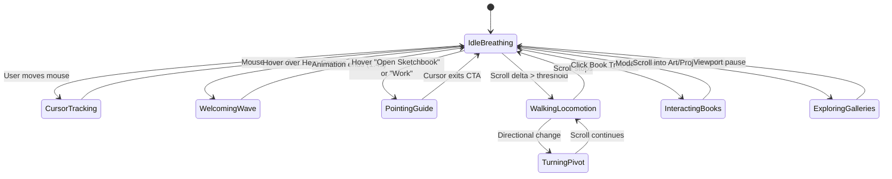
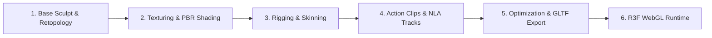

# 👤 3D Mascot Character Specification & Production Blueprint
### *Character: Stylized Srishti (Creative Technologist & Atelier Guide)*
### *Document Version: 1.1.0 (Phase 2 Design Specification — Updated from Visual References)*

---

## 1. Visual Reference Inventory & Synthesis

This character specification is directly grounded in the three reference assets located in `assets/mascot/references/`:

| Reference File | Type | Primary Role & Extracted Visual Data |
|---|---|---|
| **`Illustrated burgundy outfit characterpng.png`** | 2D Stylized Illustration | **Primary Art Style & Hero Costume Reference:** Clean stylized graphic novel / animated feature film aesthetic; rich burgundy palette; flowing traditional attire with draped dupatta and gold trim; stacked wrist bangles; jhumka earrings; bindi; dark winged eyeliner; poised, grounded demeanor. |
| **`Black traditional outfit photo.jpg`** | Real-Life Photograph | **Likeness, Posture & Silhouette Reference:** Authentic facial structure in three-quarter view; graceful, poised carriage; long dark curly/wavy hair cascading past the shoulders down the mid-back with natural curl definition; natural South Asian skin tone and traditional celebration presence. |
| **`Curly-hair casual outfit photo.jpg`** | Real-Life Photograph | **Facial Likeness & Casual Wardrobe Reference:** Direct frontal facial likeness; soft heart-shaped jawline; almond eyes with deep kohl; warm terracotta/berry lip tone; authentic dark spiral curl volume and flyaways; casual ensemble: printed botanical tube top, high-waisted relaxed light denim with patterned waist-tie scarf, and flower hair accent. |

---

## 2. Character Identity & Creative Concept

### 2.1 Core Creative Mandate
- **Identity:** A stylized, recognizable digital persona representing **Srishti Gupta** — multidisciplinary technologist, UI/UX architect, and visual artist.
- **Tone & Mood:** Poised, intellectually curious, dignified, warm, and contemporary. An inhabitant of an enchanted futuristic atelier who guides visitors through code, design, and art with welcoming grace.
- **Stylistic Fusion:** Blends the expressive charm and fluid line work of the illustrated artwork with Srishti's real-life proportions, facial structure, and hair texture.
- **Anti-Tropes (Strict Constraints):**
  - ❌ **NOT a generic fantasy fairy:** No fairy wings, pointed elf ears, gossamer tutus, or doll-like chibi proportions.
  - ❌ **NOT a wizard or sorcerer:** No wizard hats, heavy flowing academic robes, wands, staves, or medieval fantasy armor.
  - ❌ **NOT a retro-futuristic steampunk trope:** No bulky goggles on forehead, brass gears, clockwork backpacks, or industrial utility harnesses.
  - ❌ **NOT a formal uniform:** Avoid stiff military, corporate, or severe bandhgala uniforms. The primary look is organic, soft, and flowing.

---

## 3. Anatomical & Facial Likeness Specifications

```text
CHARACTER DESIGN HARMONY MATRIX
          Illustrated Art Style (Primary Aesthetic)
                     ▲
                     │   ★ MASCOT PERSONA
                     │   (Stylized Srishti)
                     │
Real-Life Likeness ──┼────────────── Contemporary Technologist
(Facial Features,    │               (Subtle ambient magic,
 Hair & Proportions) │                digital craft tools)
                     ▼
          Over-Stylized Cartoon / Anime Extremes (Avoid)
```

### 3.1 Facial Features (Derived from Photographs)
- **Face Shape:** Soft heart-shaped to gentle oval face with a delicate chin, defined jawline, and natural, high cheekbones.
- **Eyes:** Expressive, almond-shaped dark brown eyes with dark winged kohl/eyeliner (as seen in both the illustration and the casual photo). Realistic sclera depth, luminous corneal highlights, and smooth blend shapes for eye-tracking.
- **Eyebrows:** Naturally arched, soft, dark, well-defined brows capable of communicative micro-expressions (curious arch, warm welcoming lift).
- **Forehead & Bindi:** Clean forehead with an optional small, delicate deep maroon/black bindi centered between the brows (matching the illustrated reference).
- **Nose & Mouth:** Soft, well-defined nose bridge; naturally full, expressive lips with a warm berry-terracotta tint (`#8C3B3A`) capable of a gentle, engaging smile.
- **Skin Tone:** Warm golden-undertone medium brown complexion. Shaded in Blender using Subsurface Scattering (SSS) with warm peach-amber scattering around ears, cheeks, and fingertips for soft organic luminosity.

### 3.2 Hair Architecture (Dark Curly / Wavy)
- **Texture & Volume:** Thick, voluminous dark espresso/black hair with natural spiral waves and defined curls that frame the face softly, closely mirroring both real-life photographs.
- **Length & Flow:** Cascades past the shoulders down to mid-back, with organic separation, soft volume at the crown, and natural flyaway strands around the temples and forehead.
- **Hair Accents:**
  - *Hero Traditional Mode:* Loose natural cascading waves parting gently down the center/side, flowing naturally over the shoulders.
  - *Casual Studio Mode:* Soft side-swept front curl with an optional delicate warm pink/hibiscus flower accent tucked above the right ear (directly referencing `Curly-hair casual outfit photo.jpg`).
- **3D Modeling Strategy:** Optimized polygonal hair clumps layered with Alpha-Hashed textured cards or curved strands, balancing dense curly volume with WebGL rendering speed.

---

## 4. Wardrobe Specifications

### 4.1 Primary Hero Outfit: The Flowing Burgundy Ensemble
*Directly adapted from `Illustrated burgundy outfit characterpng.png`*:

| Component | Design & Silhouette | Colors & Materials | Detailing & Accents |
|---|---|---|---|
| **Bodice (Choli)** | Fitted, sleeveless bodice with a flattering scooped/sweetheart neckline. | Deep Burgundy / Rich Wine (`#5A1827` to `#6E1B2B`) in raw silk or matte crepe. | Subtle, understated embroidered cross/star motifs across the chest matching the illustrated reference. |
| **Skirt (Lehenga)** | Voluminous, floor-length flowing flared skirt gathered softly at the natural waist, sweeping gracefully around the ankles. | Matching deep burgundy flowing georgette or lightweight silk. | Generous fluid folds designed for organic cloth sway during walking and turning animations. |
| **Draped Dupatta** | Diaphanous, flowing scarf draped effortlessly over the left shoulder, sweeping across the torso and lap in soft, fluid folds. | Semi-sheer burgundy georgette. | Finished with a delicate, fine antique gold (*zari*) border (`#C8A951`) along the outer perimeter. |
| **Wrist Jewelry** | Dense stacks of silver and antique brass bangles on both wrists/forearms. | Antique silver and burnished brass (`#A0A0A0` / `#C5A059`). | Subtle metallic sheen; provides visual rhythm and cultural authenticity. |
| **Earrings** | Traditional hanging bell-shaped *jhumka* earrings. | Antique silver or aged brass filigree. | Gentle secondary physics motion when head turns. |
| **Necklace** | Delicate dark cord or fine gold chain with a small geometric/star pendant. | Dark metallic or antique brass. | Rests gently at the collarbone. |
| **Footwear** | Minimalist dark strappy flats/sandals with a toe-loop strap. | Matte black or dark espresso leather. | Low-profile, unpretentious, elegant footwear. |

---

### 4.2 Alternate Outfit: The Artistic Casual Studio Ensemble
*Directly adapted from `Curly-hair casual outfit photo.jpg`*:

| Component | Design & Silhouette | Colors & Materials | Detailing & Accents |
|---|---|---|---|
| **Top** | Strapless / tube crop top with an artistic, painterly botanical print. | Botanical earth tones: rust red (`#A04B3B`), olive moss (`#4A5A38`), and warm ivory (`#F7F4D5`). | Form-fitting stretch jersey or printed silk; celebrates modern creative individuality. |
| **Bottom** | High-waisted, relaxed wide-leg / boyfriend denim jeans. | Light-wash vintage blue denim. | Relaxed slouchy fit; subtle distressed knee detail; casual studio comfort. |
| **Waist Accent** | Patterned artisanal fabric scarf/band looped through the waistband and tied casually at the hip. | Dark patterned textile with geometric/ethnic motifs. | Hanging fabric tail adds secondary dynamic motion during movement. |
| **Hair Accent** | Soft pink floral blossom nestled into the curls above the right ear. | Warm coral-pink blossom. | Directly mirrors the reference photograph. |
| **Accessories** | Minimalist gold pendant necklace, woven friendship/string wristbands. | Warm yellow gold and dyed threads. | Relaxed, artistic, personal touchstones. |
| **Footwear** | Minimalist studio slip-ons or clean off-white sneakers. | Off-white canvas / leather. | Grounded, modern everyday studio mobility. |

---

## 5. Subtle Magical & Technological Manifestations

To preserve dignity and sophistication, all magical elements remain **delicate, contextual, and atmospheric**:

- **Bioluminescent Touch:** When the mascot gestures toward interactive UI elements (the Sketchbook, project cards, or book leaves), a faint ripple of golden-cyan light radiates softly from her fingertips.
- **Ambient Forest Spores:** 3 to 5 tiny luminous embers or bioluminescent motes drift lazily in her vicinity, bobbing with gentle organic sine-wave physics.
- **The Floating Stylus:** A sleek, minimalist digital stylus floats in gentle standby orbit near her right hand when idle, activating with a soft luminous cyan trace only when she gestures to point or sketch.
- **Strictly Excluded:** No wings, no wand, no wizard cape, no glowing magic circles on the floor, and no steampunk goggles.

---

## 6. Animation States & Motion Matrix

The mascot features a 9-state motion architecture designed to react smoothly to user input:



### 6.1 State Choreography Details
| State | Trigger | Body & Armature Motion | Facial Expression & Gaze | Loop / Behavior |
|---|---|---|---|---|
| **1. Idle Breathing** | Default state when page is still. | Gentle chest rise/fall; subtle weight shift between feet every 5–7s; draped dupatta fabric sways gently in ambient breeze. | Relaxed, welcoming expression; blink cycle every 3.5–5.0s. Soft forward gaze. | Seamless loop (6.0s duration). |
| **2. Cursor Eye-Tracking** | Cursor moves across viewport. | Head rotates up to ±25° (yaw) and ±15° (pitch); neck and upper chest blend slightly (`lerp` damping `0.05`). | Eyes follow cursor coordinates with natural saccadic micro-movements. | Additive blend layer over any base state. |
| **3. Welcoming Wave** | First mouse hover over mascot canvas. | Poised greeting: raises right hand with a relaxed, open-palm wave, slight head tilt. | Warm smile with micro-brow lift; radiates genuine hospitality. | One-shot (1.4s), smoothly blends back to Idle. |
| **4. Walking / Striding** | Visitor scrolls through pages. | Fluid, elegant walking stride; natural arm swing; draped lehenga skirt and dupatta follow with secondary cloth physics. | Focused forward gaze with gentle rhythmic breathing. | Plays forward/reverse based on scroll delta; pauses when scroll stops. |
| **5. Turning / Pivoting** | Change in scroll direction or section snap. | Clean 90° or 180° foot plant and body pivot with natural hip lead and head follow-through. | Anticipatory glance toward new focal direction. | Non-looping transition clip (0.45s). |
| **6. Pointing (Guide Mode)** | Hovering over "Open Sketchbook" or Recruiter Work CTA. | Left hand rests gracefully near waist; right arm extends forward-downward, gesturing toward the target element. | Confident encouraging smile, glancing briefly at target, then back at user. | Holds pose until cursor exits target hitbox, then 0.5s ease back to Idle. |
| **7. Interacting with Books** | Hovering or clicking a leaf on the Book Tree. | Both hands cradle a floating glowing codex leaf; fingers gently turn a holographic page. | Curious, scholarly expression; eyes track the text on the leaf. | Loops gently while takeaway modal is open. |
| **8. Exploring Galleries** | Scrolling through Living Paintings or Tech Projects. | Pauses with hands gently clasped in front (mirroring the reference illustration) or one hand at chin, observing exhibits. | Thoughtful, appreciative gaze; eyes take in the artwork. | Ambient idle loop tailored for gallery sections. |

---

## 7. Platform Architecture & Performance Target Framework

> **Important Engineering Guideline:** The metrics below represent **preliminary performance targets** to guide 3D modeling and asset optimization in Blender. They are not rigid guarantees and will be iteratively profiled and adjusted during Phase 6 based on actual browser runtime performance.

```text
                  DEVICE CAPABILITY DETECTION
                              │
             ┌────────────────┴────────────────┐
             ▼                                 ▼
   High-Tier Desktop GPU             Mobile / Low-Power Device
   Three.js + R3F WebGL Canvas       2.5D Layered SVG/WebP Sprites
   Interactive 3D Mascot             CSS Animated Character
   Preliminary Target: < 2.5 MB      Preliminary Target: < 150 KB
```

### 7.1 Desktop 3D WebGL (Preliminary Engineering Targets)
- **Geometry Target:** Full-body mesh targeted at ~35,000–50,000 triangles (including flowing skirt and layered curls).
- **Texture Maps:** PBR Metallic-Roughness workflow channel-packed into ORM maps (Red = Ambient Occlusion, Green = Roughness, Blue = Metallic) clamped to 2048x2048.
- **Compression:** Google Draco geometry compression + Meshopt.
- **Target Download Size:** Preliminary goal **< 2.5 MB** for the `.glb` container.
- **Runtime Target:** Smooth 60 FPS on mid-range discrete and integrated laptop GPUs.

### 7.2 Mobile & Low-Power 2.5D Fallback (Lightweight Target)
- **Vector / Sprite Alternative:** High-resolution layered 2.5D illustration crafted directly from the 3D model render or illustrated reference.
- **Layers:**
  1. Base Torso & Flowing Burgundy Skirt (Static).
  2. Head & Curly Hair (Gentle CSS sine-wave breathing rotate `±1.5°`).
  3. Eyes Layer (SVG blink animation keyframes).
  4. Arm / Hand Layer (Gestures on tap).
- **Target Weight:** Preliminary goal **< 150 KB**, zero WebGL overhead, flawless battery-safe rendering on any smartphone.

---

## 8. Recommended Blender to WebGL Animation Pipeline

For creating, rigging, and exporting the 3D model with maximum web efficiency, follow this industry-standard workflow:



### 8.1 Technical Production Steps

#### Step 1: Base Sculpting & Retopology (Blender / ZBrush)
- Sculpt the head and facial anatomy referencing `Curly-hair casual outfit photo.jpg` and `Black traditional outfit photo.jpg` for genuine likeness.
- Sculpt the flowing burgundy ensemble referencing `Illustrated burgundy outfit characterpng.png`.
- Retopologize to clean quad topology with concentric edge loops around the eyes and mouth to support smooth blend shapes.

#### Step 2: Rigging (Rigify or Mixamo + Custom Facial Bones)
- **Body Armature:** Use Blender's built-in **Rigify** human armature or a clean **Mixamo** base rig.
- **Facial Blend Shapes (Shape Keys):**
  - Essential facial **Morph Targets**:
    - `eyeBlinkLeft`, `eyeBlinkRight`
    - `browInnerUp`, `browOuterUp`
    - `mouthSmile`, `mouthOpen`
- **Cloth & Hair Secondary Bones:** Add bone chains through the draped dupatta, flowing skirt hemline, and side curls to enable lightweight secondary motion in Three.js.

#### Step 3: Animation Setup & Non-Linear Animation (NLA) Tracks
- Create separate distinct **Blender Actions** for each animation state:
  - `Action_Idle_Breathing` (Frames 1–180, 30fps, seamless loop)
  - `Action_Wave_Greeting` (Frames 1–45)
  - `Action_Walk_Cycle` (Frames 1–32, in-place loop)
  - `Action_Point_Guide` (Frames 1–30)
- Push each Action into an **NLA Track** and name the track cleanly. Three.js reads these as `actions['Action_Idle_Breathing']` via `@react-three/drei`'s `useAnimations()` hook.

#### Step 4: Channel-Packed Texturing
- Bake all procedural materials into PBR image textures.
- Channel pack AO, Roughness, and Metallic into a single ORM texture file to minimize HTTP requests.

#### Step 5: Exporting to Web-Ready `.glb`
In Blender's `File > Export > glTF 2.0 (.glb)` settings, configure:
- **Format:** `glTF Binary (.glb)`
- **Include:** `Limit to Selected Objects`, Check `Transform > +Y Up`
- **Geometry:** `Apply Modifiers`, Check `Compression (Google Draco)` (Compression level 7).
- **Animation:** Check `Animations`, `Shape Keys`, `NLA Tracks`.

#### Step 6: CLI Optimization
- Run `gltf-transform optimize input.glb output.glb` to prune unused data, reorder vertex caches, and ensure instant browser decoding.

---

## 9. Character Specification Approval Summary

This corrected specification establishes:
1. **Primary Art Style:** Directly derived from `Illustrated burgundy outfit characterpng.png`.
2. **Likeness & Anatomy:** Accurately anchored in `Curly-hair casual outfit photo.jpg` and `Black traditional outfit photo.jpg` (authentic jawline, dark almond eyes, warm skin tone, natural dark curly/wavy hair volume).
3. **Hero Attire:** Flowing burgundy lehenga with scooped choli, draped sheer dupatta with antique gold zari border, stacked bangles, jhumkas, and bindi.
4. **Alternate Attire:** Artistic casual look featuring printed botanical crop top, relaxed light-wash denim with patterned waist tie, and floral hair accent.
5. **Animation Framework:** 8 responsive motion states with preliminary, non-binding performance budgets.
