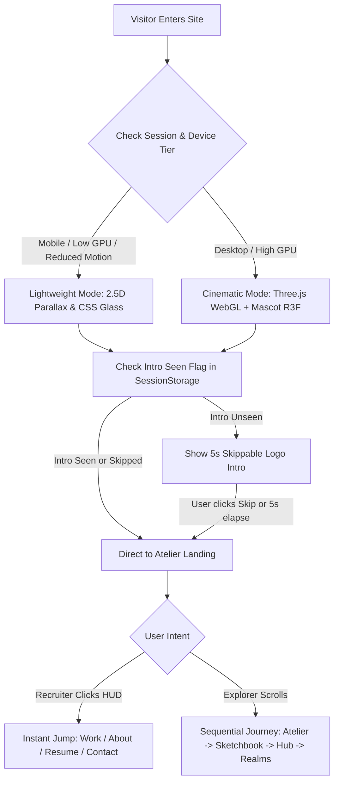

# 🏛️ Master Technical Architecture & Strategic Plan
### *Project: Srishti Gupta Portfolio Universe*
### *Document Version: 1.0.0 (Phase 1 Approved Architecture)*

---

## 1. Executive Vision & Creative World-Building

The goal of this project is to construct a genre-defining personal web portfolio for **Srishti Gupta**. It moves beyond standard flat developer portfolios to build an interactive, living digital realm:
- **The Concept:** An **Enchanted Atelier** meets a **Futuristic Inventor's Sketchbook** nestled within an **Ancient Bioluminescent Forest**.
- **The Ambience:** Floating optical lenses that act as holographic viewports; living canvas paintings that shift with perspective; a massive sacred **Book Tree** where knowledge grows like glowing leaves; mechanical brass armillaries blending medieval alchemy with quantum technology.
- **The Mascot:** An original, stylized **Futuristic Human Mascot** (visual appearance, attire, and styling to be created directly from the reference image provided by Srishti) who welcomes visitors, gestures toward interactive exhibits, and provides contextual commentary.
- **The Dual-Speed Experience:**
  - **Explorers & Art Enthusiasts:** Can journey sequentially through the skippable logo intro, the atelier, the unfolding sketchbook, and thematic portals.
  - **Recruiters & Hiring Managers:** Have an unobstructed, persistent, zero-latency **Recruiter HUD (Work • About • Resume • Contact)** styled in the magical atelier aesthetic (frosted teal glass, moss borders, ivory typography) that snaps directly to high-density career data.

---

## 2. Core Technical Requirements & Non-Negotiables

| Requirement | Architectural Specification | Implementation Strategy |
|---|---|---|
| **Recruiter Fast-Path** | 1-click access to core career assets from anywhere on the site. | Persistent fixed navigation header + slide-out Command Palette (`Ctrl/Cmd + K`) with anchors: `#work`, `#about`, `#resume`, `#contact`. |
| **Optional 3D / Graceful Degradation** | 3D features must never lock out low-power or mobile devices. | Progressive enhancement: Auto-detect GPU/hardware tier via `detect-gpu`. Low-tier devices receive a rich 2.5D CSS parallax / layered SVG fallback with zero WebGL performance tax. |
| **Performance Target** | 60 FPS on mid-range hardware; Lighthouse Performance score > 90. | Code-splitting, dynamic scene loading (`React.lazy`), GLTF compression via Draco/Meshopt, AVIF/WebP image optimization, lazy asset streaming. |
| **Zero Content Fabrication** | Absolute integrity of Srishti's real accomplishments. | Zero fake projects or placeholder company names. Data is loaded dynamically from strongly-typed JSON/TS files that Srishti populates. Empty galleries show an elegant "Work in Progress / Exhibition Curating" state. |
| **Mobile-First Responsiveness** | Flawless UX across phones, tablets, and ultrawide monitors. | Mobile view prioritizes a streamlined touch-scrollable layout, converting 3D orbit controls into touch carousels and smooth scroll scenes. |
| **Accessibility (a11y)** | WCAG 2.1 AA Compliance. | Full keyboard navigation support, high-contrast text ratios on Ivory `#F7F4D5` against Forest `#0A3323`, screen-reader friendly semantic HTML, and `prefers-reduced-motion` compliance. |

---

## 3. Technology Stack Evaluation & Selection

### 3.1 Frontend Framework & Build System (Approved for Phase 3)
- **Approved Planned Stack: Next.js (App Router) + TypeScript**
  - *Status:* Approved as the planned framework; **zero installation in Phase 1 or 2**. Scaffolding and setup will occur in Phase 3 following Figma design sign-off.
  - *Why Next.js:* Provides robust React component paradigms, static site generation (SSG) for instant recruiter load times, seamless SEO metadata, and zero-cost hosting deployment on Vercel/Netlify/GitHub Pages.

### 3.2 3D WebGL & Scene Orchestration (Planned for Phase 6)
- **Engine: Three.js via React Three Fiber (R3F) & @react-three/drei**
  - *Why R3F:* Connects 3D scene elements directly into React's state tree. A camera or mascot model can easily react to React UI state (such as switching tabs or scrolling).
  - *Drei Helpers:* Provides production-tested utilities such as `Preload`, `Float`, `Html`, `OrbitControls`, `useGLTF`, and `BakeShadows`.

### 3.3 Motion & Animation Pipeline (Planned for Phase 5)
- **Page & UI Transitions: Framer Motion**
  - Declarative spring-based animations, layout transitions (`layoutId`), gesture recognition (hover, drag, tap), and accessible reduced-motion fallbacks.
- **Complex Scroll Choreography: GSAP + ScrollTrigger or Lenis**
  - Butter-smooth inertia scrolling and pin-based animations for the Sketchbook page unfold sequence and Book Tree growth.

### 3.4 Styling & Design Tokens (Planned for Phase 3)
- **Tailwind CSS + CSS Custom Properties (Variables)**
  - Combines utility speed with centralized semantic design tokens for the provisional palette: Forest `#0A3323`, Moss `#839958`, Ivory `#F7F4D5`, Rosy Brown `#D3968C`, Midnight Teal `#105666`.
  - *Provisional Status:* The color palette is provisional and will be visually reviewed and validated in Figma during Phase 2.

---

## 4. Architectural Folder & Code Structure (Phase 3+ Engineering Roadmap)

When development begins in Phase 3 (post-Figma design approval), the source code directory will be structured as follows:

```text
src/
├── app/                           # Next.js App Router or Vite Page routes
│   ├── layout.tsx                 # Root layout with font imports and metadata
│   ├── page.tsx                   # Main narrative experience orchestrator
│   └── globals.css                # Global CSS variables, resets, and typography
│
├── components/                    # Modular, reusable UI components
│   ├── common/                    # Primitive elements: Button, Badge, Modal, Tooltip
│   ├── navigation/                # RecruiterHUD, MobileDrawer, SoundToggle, SkipIntroButton
│   ├── sketchbook/                # 3D/CSS folding book wrapper, page turners, leather cover
│   ├── portals/                   # Realm gateways, glowing runic card frames
│   └── feedback/                  # Loading screen, 3D fallback notices, error boundaries
│
├── scenes3d/                      # Three.js / R3F Canvas components
│   ├── AtelierCanvas.tsx          # Main WebGL viewport with lighting & camera controls
│   ├── MascotModel.tsx            # GLTF humanoid mascot with rigging, idle gestures, and follow-cursor
│   ├── BookTreeScene.tsx          # Mystical arboretum with floating leaf-folios
│   ├── LivingCanvas.tsx           # Shader-based interactive painting planes
│   ├── ParticleField.tsx          # Luminous embers and enchanted forest motes
│   └── PerformanceGate.tsx        # Device capability detection and fallback switcher
│
├── sections/                      # The 11 core experiential realms
│   ├── IntroSequence.tsx          # 5-second skippable celestial logo reveal
│   ├── AtelierLanding.tsx         # Workshop hero section
│   ├── SketchbookOverview.tsx     # Physical unfolding philosophy journal
│   ├── CreativeHub.tsx            # Realm selector compass
│   ├── TechnicalProjects.tsx      # Filterable code showcase
│   ├── GraphicDesign.tsx          # Figma embeds, brand identities, UI/UX cases
│   ├── VideoEditing.tsx           # Motion graphics and video reel cinema
│   ├── PaintingGallery.tsx        # Traditional & digital art with zoom inspector
│   ├── BookTree.tsx               # Reading leaves, literature wisdom, quote drawer
│   ├── Extracurriculars.tsx       # Leadership, speaking, and community initiatives
│   ├── Achievements.tsx           # Hackathons, honors, verified credentials
│   ├── CosmicGifts.tsx            # Physical handmade crafts, 3D craft viewer
│   ├── AboutStory.tsx             # Srishti's journey, philosophy, skills matrix
│   ├── ResumeSection.tsx          # Interactive career timeline + ATS PDF download
│   └── ContactPortal.tsx          # Communication desk, inquiry form, social glyphs
│
├── data/                          # Typed JSON / TS content repositories (User editable)
│   ├── technicalProjects.ts       # Real software engineering projects
│   ├── designProjects.ts          # Real Figma & graphic design case studies
│   ├── videoProjects.ts           # Real video edits and motion reels
│   ├── paintings.ts               # Real artwork gallery records
│   ├── books.ts                   # Real books read and insights
│   ├── extracurriculars.ts        # Real leadership and club experiences
│   ├── achievements.ts            # Real hackathon wins and certificates
│   ├── cosmicGifts.ts             # Real handmade artifacts and keepsakes
│   ├── profile.ts                 # Real bio, resume bullet points, contact info
│   └── siteConfig.ts              # Site metadata, feature toggles, intro duration
│
├── hooks/                         # Custom React hooks
│   ├── useDeviceTier.ts           # Detects mobile/low-GPU devices for 3D fallback
│   ├── useAudioController.ts      # Soundscape management with mute persistence
│   ├── useSketchbookScroll.ts     # Maps scroll delta to page flip percentages
│   └── useReducedMotion.ts        # Respects system accessibility preferences
│
└── types/                         # TypeScript interface definitions
    └── index.ts                   # Strict schemas for all data models
```

---

## 5. Performance, 3D Optimization & Fallback Strategy



### 5.1 Optimization Checklist for 3D & Media
1. **Asset Pipeline:**
   - 3D models stored in Draco-compressed `.glb` format (< 3MB total for hero mascot).
   - Textures capped at 1024x1024 or 2048x2048 using WebP/KTX2 texture compression.
   - Videos lazy-loaded; previews use looped silent WebM/MP4 micro-clips under 1.5MB.
2. **WebGL Draw Call Reduction:**
   - Single shared particle buffer for luminous forest motes instead of individual mesh instantiations.
   - Frustum culling enabled so off-screen 3D scenes stop rendering immediately.
3. **Soundscape Protocol:**
   - Audio is **off by default** in accordance with web accessibility standards.
   - An ambient sound toggle button with subtle visual sound waves allows the visitor to opt-in to magical forest chimes and atelier acoustic resonance.

---

## 6. Multi-Phase Project Roadmap

- **Phase 1: Foundations, Design System & Master Blueprint (COMPLETE)**
  - Git repository structure, comprehensive documentation, folder architectures, Figma screen inventories, data schemas, interaction specifications, learning guides.
- **Phase 2: Figma UI/UX Wireframing & Visual Design (NEXT PHASE — Strictly No Code)**
  - Desktop (1440px) and Mobile (390px) wireframes and high-fidelity screen mockups in Figma.
  - Visual review, contrast testing, and refinement of the provisional magical forest palette.
  - Character visual design once Srishti provides the mascot reference image.
  - Recruiter HUD styling and interactive component states.
- **Phase 3: Core Engineering Setup, Base UI & Recruiter Fast-Path**
  - Project scaffolding with Next.js (App Router) + TypeScript + Tailwind CSS.
  - Implementation of base UI components, typography tokens, and the atelier-styled Recruiter HUD.
  - Responsive container layout and accessible ATS resume viewer.
- **Phase 4: Content Ingestion & Dynamic Gallery Engine**
  - Structured TypeScript data population by Srishti (`src/data/`), responsive grid/masonry systems, modal inspectors, Figma prototype embeds, video player integration.
- **Phase 5: 2D Motion, Sketchbook Unfold & Living Canvas Effects**
  - Framer Motion page transitions, GSAP scroll-triggered sketchbook page flips, mouse-responsive living painting parallax, soundscape engine.
- **Phase 6: 3D Atelier & Mascot Integration (Optional / Progressive Enhancement)**
  - WebGL canvas setup via Three.js / R3F, 3D mascot model loading (modeled from reference image), particle embers, 3D Book Tree arboretum, GPU capability gate.
- **Phase 7: Quality Assurance, Accessibility Audit & Production Launch**
  - Lighthouse 90+ audit, keyboard navigation testing, cross-browser verification (Chrome, Safari, Firefox, Edge, iOS, Android), deployment to custom domain.
