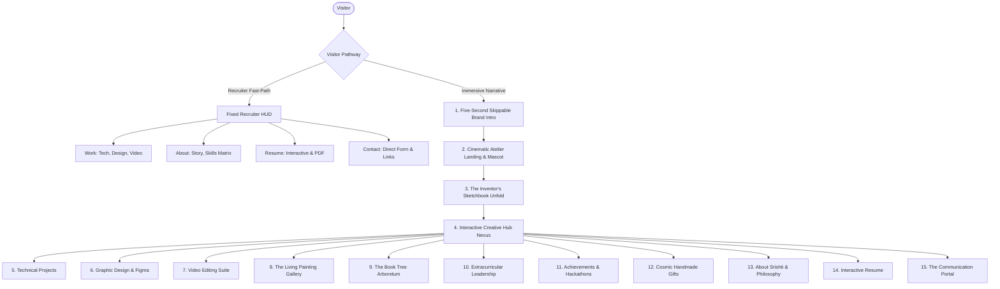

# 🗺️ Site Architecture & Page Map
### *Project: Srishti Gupta Portfolio Universe*
### *Document Version: 1.0.0 (Phase 1 Approved Architecture)*

---

## 1. High-Level Information Architecture (IA)

The website is engineered as a unified single-page progressive application (SPA) with deeply linked thematic anchors. This guarantees that visitors looking for an immersive artistic experience can explore fluidly, while busy technical recruiters can navigate instantly with zero cognitive friction.

---

## 2. The Recruiter Fast-Path Specification

The **Recruiter HUD** is permanently anchored at the top of the viewport across all devices and all scroll depths.

### Visual Elements & Atelier Styling:
- **Styling:** Frosted midnight teal glass (`rgba(16, 86, 102, 0.7)`), subtle verdant moss borders (`rgba(131, 153, 88, 0.35)`), and high-contrast ancient ivory runes (`#F7F4D5`), seamlessly harmonizing with the magical atelier aesthetic.
- **Monogram Brandmark:** Srishti Gupta (clicking returns smoothly to top).
- **Direct Anchor Links:**
  - `[Projects & Work]` (Dropdown or jump to filtered showcase)
  - `[About Srishti]` (Jumps to bio, philosophy, and technical stack matrix)
  - `[Resume]` (Jumps to interactive timeline with direct ATS PDF download button)
  - `[Contact]` (Jumps to direct email, LinkedIn, and inquiry form)
- **Controls Cluster:**
  - **3D / Performance Toggle:** Allows manual switching between `Cinematic 3D` and `Lightweight 2.5D`.
  - **Audio Mute/Unmute:** Visualized by subtle bouncing sound bars (default: muted).
  - **Quick Menu (Mobile):** Slide-out parchment drawer.

---

## 3. Detailed Section-by-Section Anatomy

### Section 1: Five-Second Skippable Brand Intro
- **Purpose:** Establishes the celestial tone, introducing Srishti Gupta’s monogram in a glowing brass constellation.
- **Duration:** Exactly 5.0 seconds with a visible animated progress bar.
- **Skip Mechanism:** Prominent `[Skip Intro ➔]` button positioned in the top-right corner.
- **Memory Persistence:** When a visitor clicks "Skip" or finishes the intro, an entry is written to browser `sessionStorage`. Subsequent visits in the same session bypass the intro immediately.
- **Desktop View:** Fullscreen canvas with glowing celestial particles converging to forge Srishti's monogram.
- **Mobile View:** Lightweight vector animation with responsive typography and high-contrast skip button.

---

### Section 2: Cinematic Atelier Landing & Mascot
- **Purpose:** The emotional anchor and first interactive touchpoint.
- **Visuals:** An open-air artist workshop nestled inside an ancient hollow luminescent tree. Floating optical lenses refract forest light.
- **The Human Mascot:** An animated futuristic human mascot whose visual appearance, character styling, and attire will be created directly from the reference image provided by Srishti. The mascot breathes, makes gentle eye contact with the cursor, and gestures welcomingly toward the sketchbook.
- **Core Call-to-Actions (CTAs):**
  - Primary CTA: *"Open the Sketchbook"* (smooth-scrolls to Section 3).
  - Secondary CTA: *"View Technical Work (Recruiter Mode)"* (bypasses to Section 5).
- **Desktop vs. Mobile:** On desktop, the mascot is a 3D rigged model responding to pointer position; on mobile or low-power devices, an optimized 2.5D illustrated SVG/WebP character with CSS idle breathing animations.

---

### Section 3: The Inventor's Sketchbook Unfold
- **Purpose:** Bridges artistic intuition with engineering principles.
- **Mechanics:** As the user scrolls, a physical, leather-bound notebook with gold-leaf tooling slides onto the screen and unfolds its pages in 3D perspective.
- **Page Contents:**
  - Left Page: Hand-drawn technical schematics, architectural philosophy notes, and foundational core values.
  - Right Page: Interactive tabs summarizing Srishti's multi-hyphenate domains: Code, Visual Design, Motion, and Craft.
- **Desktop vs. Mobile:** Desktop uses continuous scroll-driven 3D page bending via GSAP/ScrollTrigger; Mobile displays a sleek swipeable card deck reminiscent of sketchbook leaves.

---

### Section 4: The Interactive Creative Hub (Navigational Nexus)
- **Purpose:** An interactive celestial compass allowing visitors to filter or teleport to any of the 11 creative realms.
- **Categories Displayed:**
  - `Engineering & Code`
  - `UI/UX & Graphic Design`
  - `Motion & Video Editing`
  - `Fine Art & Painting`
  - `Literature & The Book Tree`
  - `Leadership & Hackathons`
  - `Handmade Craft & Cosmic Gifts`
- **Interaction:** Hovering over any realm node illuminates a glowing portal preview and shows the count of curated works inside.

---

### Section 5: Technical Projects Realm
- **Purpose:** Highlights software engineering prowess, full-stack applications, and technical research.
- **Features:**
  - Filter pills: `All`, `Full-Stack`, `Frontend / WebGL`, `AI / ML`, `Tools & Systems`.
  - Project Cards: Crisp visual previews, live demo links, GitHub links, architecture badges, and technical challenges overcome.
  - Modal Deep-Dive: Clicking a project opens an architect's blueprint drawer with code architecture diagrams and performance metrics.
- **Zero-Invention Standard:** Srishti adds real project entries manually via `data/technicalProjects.ts`.

---

### Section 6: Graphic Design & Figma Realm
- **Purpose:** Demonstrates visual storytelling, user experience design, wireframing, design systems, and vector craft.
- **Features:**
  - Interactive Figma prototype viewer embeds (clean iframes or high-resolution zoomable mockups).
  - Design system tokens showcase (color harmony, typography scales, component specs).
  - Case study cards with before-and-after comparisons and problem-solving rationales.
- **Zero-Invention Standard:** Driven manually by `data/designProjects.ts`.

---

### Section 7: Video Editing Suite
- **Purpose:** Displays motion design, narrative pacing, audio synchronization, and post-production capabilities.
- **Features:**
  - High-impact showreel video hero player with custom audio-visual controls.
  - Grid of edited projects with duration tags, software used (e.g., Premiere, After Effects, DaVinci), and role (Editing, Color Grading, Sound Design).
  - Video Lightbox: Click-to-expand cinema modal with zero buffering lag.
- **Zero-Invention Standard:** Driven manually by `data/videoProjects.ts`.

---

### Section 8: The Living Painting Gallery
- **Purpose:** Celebrates fine art, digital painting, traditional oil/acrylics, and concept art.
- **Living Effect:** Hovering mouse across a painting activates a subtle depth map displacement (parallax) and a delicate light glaze, making the brushstrokes feel alive.
- **Features:**
  - High-resolution zoom inspection tool to view brush texture.
  - Artwork metadata: Medium, Dimensions/Canvas type, Year, and Conceptual statement.
- **Zero-Invention Standard:** Driven manually by `data/paintings.ts`.

---

### Section 9: The Book Tree (Wisdom Arboretum)
- **Purpose:** A unique personal reading arboretum showcasing Srishti's intellectual curiosities, books read, and favorite quotes.
- **Visuals:** An ancient digital tree whose branches hold floating leaf-folios.
- **Interaction:** Clicking a leaf opens a miniature parchment slip showing:
  - Book title and author.
  - Srishti's personal synthesis / key mental model learned.
  - Favorite highlighted passage.
  - Category tags: `Philosophy`, `Technology`, `Art & Design`, `Speculative Fiction`.
- **Zero-Invention Standard:** Driven manually by `data/books.ts`.

---

### Section 10: Extracurriculars Realm
- **Purpose:** Highlights community leadership, mentoring, volunteerism, university clubs, and event organizing.
- **Layout:** An illustrated timeline / network map of impact, displaying roles, initiatives launched, and community reach.
- **Zero-Invention Standard:** Driven manually by `data/extracurriculars.ts`.

---

### Section 11: Achievements & Hackathons Realm
- **Purpose:** Rigorous validation of competitive excellence, awards, hackathon victories, and academic milestones.
- **Features:**
  - Trophy shelf presentation with verified credential badges.
  - Project name associated with each hackathon, team size, challenge brief, and prize won.
  - Verified links to Devpost, certificates, or press announcements.
- **Zero-Invention Standard:** Driven manually by `data/achievements.ts`.

---

### Section 12: Cosmic Handmade Gifts Realm
- **Purpose:** Highlights tangible physical creativity — artisan jewelry, handmade keepsakes, sculptured gifts, origami, or physical crafts.
- **Features:**
  - Multi-angle photographic carousel for each handmade artifact.
  - Optional interactive 3D object scan or rotating pedestal viewer.
  - Materials list (e.g., polymer clay, resin, brass wire, recycled paper).
- **Zero-Invention Standard:** Driven manually by `data/cosmicGifts.ts`.

---

### Section 13: About Srishti & Creative Ethos
- **Purpose:** Contextualizes Srishti Gupta's background, multidisciplinary ethos, and work philosophy.
- **Components:**
  - Portrait photograph embedded within an organic brass-bordered frame.
  - Personal narrative: How the engineer's logic enhances the artist's eye, and vice-versa.
  - Core Skill Matrix: Filterable by `Code & Engineering`, `UI/UX & Design`, `Motion & Media`, `Art & Craft`.
  - Values: Precision, Curiosity, Human-Centricity, Craftsmanship.

---

### Section 14: Interactive Resume Realm
- **Purpose:** Frictionless, ATS-friendly evaluation for recruiters and interviewers.
- **Features:**
  - One-Click Action: **Download PDF Resume** (clean, recruiter-vetted format).
  - Interactive Experience Timeline: Filter by `Professional Experience`, `Education`, and `Certifications`.
  - Printable clean mode toggle.
- **Zero-Invention Standard:** Loaded directly from `data/profile.ts`.

---

### Section 15: The Communication Portal (Contact)
- **Purpose:** The concluding call to action for collaborations, employment, and inquiries.
- **Visuals:** An inventor's communication desk with an antique brass telegraph key or illuminated inkwell.
- **Elements:**
  - Direct email trigger (`mailto:` with copy-to-clipboard toast).
  - Social runes / links: LinkedIn, GitHub, Figma Community, Behance, X/Twitter, Instagram.
  - Clean inquiry form: Name, Email, Subject, Message, and Inquiry Type (Full-time Role, Freelance, Collaboration, Coffee Chat).
- **Accessibility:** Form fields clearly labeled with assistive text and instant validation feedback.

---

## 4. Responsive Breakpoints & Viewport Adaptations

| Device Class | Viewport Range | Layout Strategy | 3D / WebGL Adaptation |
|---|---|---|---|
| **Mobile Portrait** | `320px – 480px` | Single-column linear stack, bottom sticky recruiter pill, touch swipe carousels. | 2.5D CSS parallax layers; 3D mascot simplified to 2D illustrated avatar. |
| **Mobile Landscape / Small Tablet** | `481px – 768px` | 2-column compact grid, collapsed sidebar HUD. | Low-poly mascot with reduced particle count (max 150 particles). |
| **Tablet Portrait / Large Tablet** | `769px – 1024px` | 2-column asymmetric layout, persistent top HUD. | Standard 3D scene with dynamic shadow mapping disabled. |
| **Desktop / Laptop** | `1025px – 1440px` | Multi-column grid, full interactive sketchbook unfold, side-docked drawers. | Full 3D WebGL enabled with 60fps target and particle fields. |
| **Ultrawide & 4K** | `1441px+` | Max content container width clamped to `1440px` with ambient forest edge vignetting. | Full 3D WebGL with ultra-sharp antialiasing and depth-of-field shaders. |
