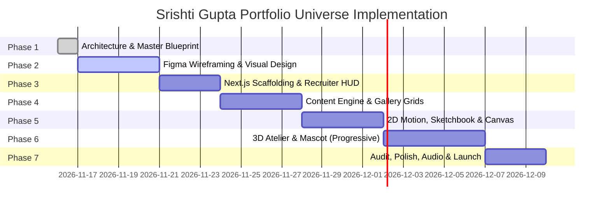

# 📈 Project Roadmap & Phase Progress Ledger
### *Project: Srishti Gupta Portfolio Universe*
### *Document Version: 1.0.0 (Phase 1 Approved Architecture)*

---

## Scene 01 character-led landing

The landing now follows a ten-second forest approach into a centered, full-length hero shot. The title is rendered behind the guide in the 3D scene, with separate portrait artwork and a semantic HTML heading. The existing guide responds to desktop WASD and taps on the rug on touch layouts. Travel stays on the atelier floor, with eased turns and a restrained camera follow. Clicking the guide plays her existing wave.

All three private references were reviewed locally. The burgundy illustration governs wardrobe and accessories. The two photographs establish likeness and hair from different angles. The landing stand-in's drape now crosses from the illustrated shoulder. The production character remains unfinished. Blender was unavailable locally and the project contains no matching rigged asset. The stand-in's walking motion is an approximation and has no skeletal footfall or cloth simulation. No photos are copied into public files.

The book and realms retain their existing cameras, data and interactions. Scene 01 screenshots are stored locally in the ignored `test-results/` directory as `scene01-before-*` and `scene01-after-*`.

## Cinematic visual quality pass — 19 November 2026

1. The atelier has a warmer interior against cool forest light, a denser canopy, a woven rug, a painter's palette, denser desk grain and hanging pendants. The stool seat now sits horizontally.
2. The mascot reads larger in the frame, with brow and garment details, smoother gaze and body motion, lagging curls and a jointed wave.
3. The sketchbook seal and seam illuminate before the full reveal. Objects rise in staggered trajectories with tinted trails. Paper edges are visible, and the outgoing leaf rolls around its hinge.
4. The interface uses editorial serif type and tighter spacing on narrow screens. The audio control has a taller hit area, and opening and turning sounds share the ambient volume and mute controls.

The actual before and after images are in the ignored `test-results/` directory under `quality-before-*` and `quality-after-*`. The existing portfolio records and private references were preserved. The user authorized normal commits and a fast-forward push to `origin/main` after validation, with deployment excluded. The wardrobe, face, and environment remain stylized procedural models. None is a finished Blender sculpt or a rigged likeness.

Browser review caught a blank right-hand page on hardware after lazy texture generation. The open-book materials now mount with their textures ready. The turning leaf has separately rendered front and back artwork, and the matte page finish keeps the ink visible under the desk lighting.

TypeScript, ESLint, four unit tests, eight desktop/mobile browser cases and the production build passed. The four browser cases covering the book and realm navigation also passed after the final page correction. The hardware captures used local Edge at 1440 × 900 and 390 × 844. Physical phone performance is unverified.

## Earlier cinematic rebuild checkpoint

The latest mission replaces the five-second intro with a ten-second forest approach and moves all six creative chapters into the physical book. Do not commit, push, or deploy without approval.

Current local changes: custom curved tree architecture, modeled forest foliage and roots, atmospheric shaders and fireflies, carved desk, quieter UI; new physical book with cover approach/opening, temporary object reveal, paper bending and page textures; six chapters in the requested order; six realm foundations and WASD gallery movement; original synthesized looping ambience with opt-in play/mute/volume; improved procedural curls, blinking and head tracking.

Latest Figma review is **blocked**: the connector reports the Starter-plan MCP call limit, and the public link is inaccessible. No latest Figma edits have been claimed as reviewed. Blender was not found in PATH or the usual installation directory. Current geometry and animation are authored with Three.js; they remain procedural work, not final Blender assets or a production character likeness.

Current validation: TypeScript, ESLint, four state-transition tests, eight updated desktop/mobile browser tests and production build pass. Browser tests cover the new book navigation, chapter order, realm walking/return, ten-second intro, audio controls and fallback. The final portrait-camera framing adjustment also passed all four targeted mobile tests and a fresh production build. See CINEMATIC_REBUILD.md for active architecture and remaining gaps. The existing localhost process should be reused if it still responds at http://127.0.0.1:3000.

Final return-path refinement is also verified: entering a realm and returning preserves the selected, already-open chapter and does not replay the cover/reveal. All eight browser tests and a fresh build pass after this change. Hardware screenshots were visually reviewed. A local source-only recovery archive is saved at temp/cinematic-rebuild-checkpoint-20261118.zip; it excludes private reference photos, dependencies and build output. Nothing was staged or committed.

Short hardware-accelerated Edge samples on this laptop's Intel GPU: 60.1 FPS at 1440×900 (362 draws / 158,218 triangles), 60.0 FPS at 390×844 (243 draws / 61,352 triangles). These are five-second viewport samples, not physical-phone or cross-browser guarantees. Software-only rendering remains slower: final adaptive samples were 11.6 FPS desktop and 17.3 FPS mobile. Gentle mode now reduces geometry, batches repeated plants/books, simplifies distant diffuse materials, and lowers resolution under sustained low frame rates; quiet mode remains available.

Actual screenshots are in ignored test-results/: hardware-desktop-studio-final.png, hardware-desktop-bloom-final.png, hardware-desktop-book-final.png and equivalent hardware-mobile images, plus all six realm captures from the browser suite. No code was committed or staged. No push/deployment was performed. Private photos were read for character guidance and remain ignored; none were copied to public assets.

Still incomplete: custom character likeness/sculpt/rig and natural skeletal locomotion; production-quality authored environment assets; full content-specific activities in all six realm foundations; real portfolio content, resume/contact details and media; physical-device and Safari/Firefox audits. Do not describe the procedural models or empty exhibitions as finished production artwork.

## Implementation recovery checkpoint — 18 November 2026

The user's implementation mission and resume request supersede the historical no-code gate below. Historical design decisions remain preserved.

- Repository: `C:\Users\gupta\OneDrive\Desktop\projects\srishti-gupta-portfolio`.
- Recovered source is intact; both test files were zero-filled by the shutdown and have been restored.
- Runtime and development dependencies, including Node types, are installed and locked in `package-lock.json`.

| Mission milestone | Verified implementation | Remaining work |
| --- | --- | --- |
| 1 — Foundation | Next.js App Router, TypeScript, Tailwind, Three/Fiber/Drei; local dev server returns HTTP 200 | None for local setup |
| 2 — Atelier | Real procedural geometry; instanced forest, roots and foliage; circular plank floor, partial canopy, braces, warm arched windows, furniture, books, easel, plants, particles and lighting | Further production art polish and real-device profiling |
| 3 — Narrative | Skippable/session-aware five-second intro, camera approach, hinged book, bending page movement, four pages, clickable 3D portal compass, return controls | More detailed physical page artwork and richer cinematic choreography |
| 4 — Content and gallery | All eight requested hub entries; typed verified-content schema; empty exhibitions; camera navigation and frame inspection; easel/bookshelf shortcuts | Real projects/media; specialized reading, motion, honors and gift experiences currently share the gallery foundation |
| 5 — Mascot | Temporary burgundy human-shaped guide, curly hair, jewelry, pleated skirt; idle/wave/walk/run/turn/interact/celebrate/sit blocking poses | Custom likeness, skeletal rig, polished locomotion and cloth/hair animation |
| 6 — Access and performance | Persistent recruiter access, keyboard/touch controls, native modal focus/Escape, command search, reduced motion, quiet SVG/HTML fallback, WebGL error boundary; limited DPR/shadows, instancing, adaptive quality, hidden-tab/modal rendering pause, listener cleanup | Screen-reader audit, physical device and cross-browser testing |
| 7 — Verification | TypeScript, ESLint, 3 state tests, all 8 desktop/mobile browser tests and final production build pass; visual review and 3 final corrected captures complete | Physical-device, assistive-technology, Lighthouse and cross-browser audits; no launch performed |

### Recovered issues fixed

Restored two zero-filled test files; finished missing installations; fixed texture cleanup, camera-to-gallery handoff, hidden book illustrations, grain aliasing, quiet-mode realm selection, favicon 404 and Enter-key default activation. Reformatted source for maintainability. The private reference images were not edited or copied to public output.

### Safe resume instructions

1. Read this checkpoint and `docs/QA_NOTES.md`; inspect `git status` before changing files.
2. Run `npm.cmd ci` if dependencies are missing, then `npm.cmd run typecheck`, `npm.cmd run lint`, `npm.cmd test`, `npm.cmd run build`.
3. Start `npm.cmd run dev`; use `http://127.0.0.1:3000`. In another terminal run `npm.cmd run test:browser`. Edge is installed locally. Screenshots are ignored under `test-results/`.
4. Do not assume previous processes survived. Stop an owned server with Ctrl+C before restarting it. Never run concurrent dependency installers.
5. Add only verified work in `src/data/portfolio.ts`; copy only approved public media into `public/`. Keep raw private mascot photos in ignored `assets/mascot/references/`.
6. Keep the custom mascot/real-content gaps explicit. Do not present MAITRI/OASIS as completed contributions. No push or deployment is authorized.

Production dependencies have zero audit findings. Development tooling currently has 14 findings rooted in an unpatched picomatch advisory; see `docs/QA_NOTES.md`. Hardware 60 FPS, Lighthouse, Safari/iOS/Android and screen-reader compliance have not been established.

### Git handoff

Implementation commit: **`ed366e1` — `feat: build interactive woodland atelier portfolio`**. The subsequent documentation commit records this checkpoint and QA results; use `git log -2 --oneline` for its hash. Source and documentation were committed separately after successful checks. No push or deployment has been performed. Historical planning sections below are retained verbatim except for their historical heading.

Final validation: `npm.cmd run typecheck`, `npm.cmd run lint`, `npm.cmd test` (3/3), `npm.cmd run test:browser` (8/8) and `npm.cmd run build` all pass. The browser suite checks console errors; final corrected book/portal screenshots were also captured without page errors. Screenshots: `test-results/desktop-studio-final.png`, `desktop-book-final.png`, `desktop-portals-final.png`, plus the desktop/mobile suite images. The owned development server is stopped during handoff; restart using the commands above.

## 1. Historical Executive Status Dashboard

- **Current Status:** **Phase 1 Complete & Formally Approved**
- **Next Phase:** **Phase 2: Figma UI/UX Wireframing & Visual Design** *(STRICTLY NO CODE / NO WEB IMPLEMENTATION)*
- **Repository Branch:** `main` (clean, uncommitted workspace)
- **Zero Fabrication Compliance:** **VERIFIED** (No fabricated projects, dummy metrics, or synthetic claims)

---

## 2. Phase 1 Deliverables Audit

| Milestone Deliverable | Target Path | Status | Verification Summary |
|---|---|---|---|
| **Git Repository Inspection** | Root directory | ✅ Complete | Inspected empty Git repo on branch `main` with no prior commits. |
| **Clean Folder Hierarchy** | `docs/`, `design/`, `assets/` subdirs | ✅ Complete | Created organized folders for mascot, artwork, videos, books, graphics, gifts, audio, icons, documents. |
| **Professional README** | `README.md` | ✅ Complete | Master overview of creative vision, provisional palette, dual-path architecture, directory structure, and roadmap. |
| **Master Technical Blueprint** | `docs/MASTER_PLAN.md` | ✅ Complete | Planned Next.js stack, performance gates, 3D fallbacks, and updated 7-phase roadmap. |
| **Site Architecture & Page Map** | `docs/PAGE_MAP.md` | ✅ Complete | Complete information architecture for all 11 realms, atelier-styled recruiter HUD, and responsive breakpoint specs. |
| **Design System & Figma Inventory**| `docs/DESIGN_SYSTEM.md` | ✅ Complete | Color tokens (provisional), typography scales, Figma screen inventory (Desktop & Mobile), and component library specs. |
| **Interaction & Motion Choreography** | `docs/INTERACTIONS.md` | ✅ Complete | 5s skippable intro timeline, mascot motion matrix (agnostic to attire/goggles), 3D sketchbook unfold, living paintings, and recruiter bypass. |
| **Content Schemas & Ingestion Plan** | `docs/CONTENT_PLAN.md` | ✅ Complete | Zero-invention TypeScript schemas for manual project input, asset dimension specs, and compression rules. |
| **Beginner Technologist Guide** | `docs/LEARNING_GUIDE.md` | ✅ Complete | Gentle, plain-English explanations of WebGL, Three.js, shaders, TypeScript, folder maps, and pitfalls. |
| **Phase Progress & Approval Gate** | `docs/PHASE_PROGRESS.md` | ✅ Complete | Tracking ledger, milestone checklists, and Phase 1 review decisions log. |

---

## 3. Phase 1 User Review Decisions & Approvals Log

The following decisions were established during the Phase 1 Review:

1. **Planned Framework Selection:**
   - **Decision:** **Next.js + TypeScript + Tailwind CSS** approved as the planned engineering framework.
   - **Directive:** **Do not install anything yet.** All code installation and scaffolding is deferred to Phase 3.
2. **Color Palette Status:**
   - **Decision:** The magical forest palette (Forest `#0A3323`, Moss `#839958`, Ivory `#F7F4D5`, Rosy Brown `#D3968C`, Midnight Teal `#105666`) is **provisional**.
   - **Directive:** It will be visually evaluated, stress-tested, and finalized inside Figma during Phase 2.
3. **Mascot Conception & Reference Image:**
   - **Decision:** Mascot is **not finalized or designed yet**. Srishti will provide a visual reference image.
   - **Directive:** All assumptions regarding goggles, artisan workwear, or specific accessories have been removed. Motion choreography remains abstract and ready for any character design.
4. **Recruiter Navigation Styling:**
   - **Decision:** **Approved.** Direct access to Work, About, Resume, and Contact is approved and will be styled to match the magical atelier aesthetic (frosted teal glass, moss borders, ivory typography).
5. **Phase 2 Scope Definition:**
   - **Decision:** **Phase 2 is dedicated to Figma UI/UX Wireframing & Visual Design**, NOT engineering or website development.
   - **Directive:** No code, no package installs, no commits, and no pushes.

---

## 4. Multi-Phase Roadmap Ahead

### Detailed Breakdown of Phases:
- **Phase 1: Foundations, Design System & Master Blueprint (COMPLETE)**
- **Phase 2: Figma UI/UX Wireframing & Visual Design (NEXT — No Code / No Web Dev)**
  - Draft low-fidelity and high-fidelity wireframes across Desktop (1440px) and Mobile (390px) matching the Figma Screen Inventory.
  - Visually review, contrast-test, and finalize the provisional magical forest color palette.
  - Character visual design in Figma once Srishti provides the mascot reference image.
  - Atelier-styled Recruiter HUD design and micro-interaction visual states.
- **Phase 3: Core Engineering Setup, Base UI & Recruiter Fast-Path (Code Scaffolding)**
  - Initialize project with Next.js (App Router) + TypeScript + Tailwind CSS.
  - Implement base UI components, typography tokens, and the atelier-styled Recruiter HUD.
  - Build responsive container layout and accessible ATS resume viewer.
- **Phase 4: Content Ingestion & Dynamic Gallery Engine**
  - Implement strongly-typed data files in `src/data/` for Srishti to populate.
  - Build responsive grids for Technical Projects, Graphic Design (with Figma embeds), Video Editing, Extracurriculars, Achievements, and Cosmic Handmade Gifts.
  - Implement empty-state "Curating Exhibition" fallbacks.
- **Phase 5: 2D Motion, Sketchbook Unfold & Living Canvas Effects**
  - Integrate Framer Motion page choreography and GSAP scroll-triggered 3D sketchbook opening.
  - Implement mouse-responsive parallax shader effects for the Living Painting Gallery.
  - Add optional ambient audio player with sound wave toggle.
- **Phase 6: 3D Atelier & Mascot Integration (Optional / Progressive Enhancement)**
  - Integrate Three.js / React Three Fiber canvas.
  - Load and render the 3D human mascot (modeled from Srishti's reference image).
  - Implement 3D Book Tree arboretum and floating spore particle field.
  - Wire up `detect-gpu` device capability gate for automatic 2.5D fallback.
- **Phase 7: Quality Assurance, Accessibility Audit & Production Launch**
  - Run Lighthouse performance, accessibility, SEO, and best-practice audits (aiming for 90+ across all).
  - Test keyboard tab navigation, screen reader ARIA landmarks, and `prefers-reduced-motion` compliance.
  - Test across Chrome, Safari, Firefox, iOS, and Android.
  - Assist with deployment to personal domain (e.g., via Vercel, Netlify, or GitHub Pages).

Final portrait visual QA: widened the foreground forest corridor so the frontal mobile camera has a clear view of the desk and sketchbook. Fresh hardware desktop/mobile captures report no page errors, and the production build passes after this correction. The guide remains close to the portrait left edge; further character/framing polish is unfinished.
